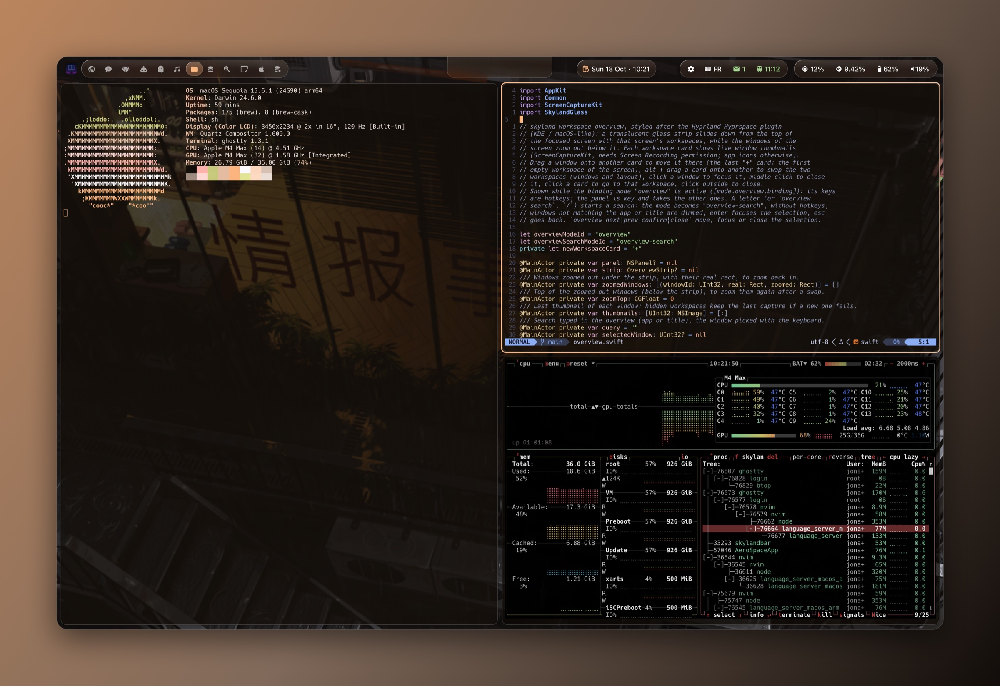
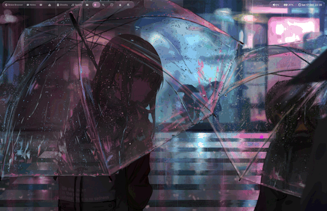
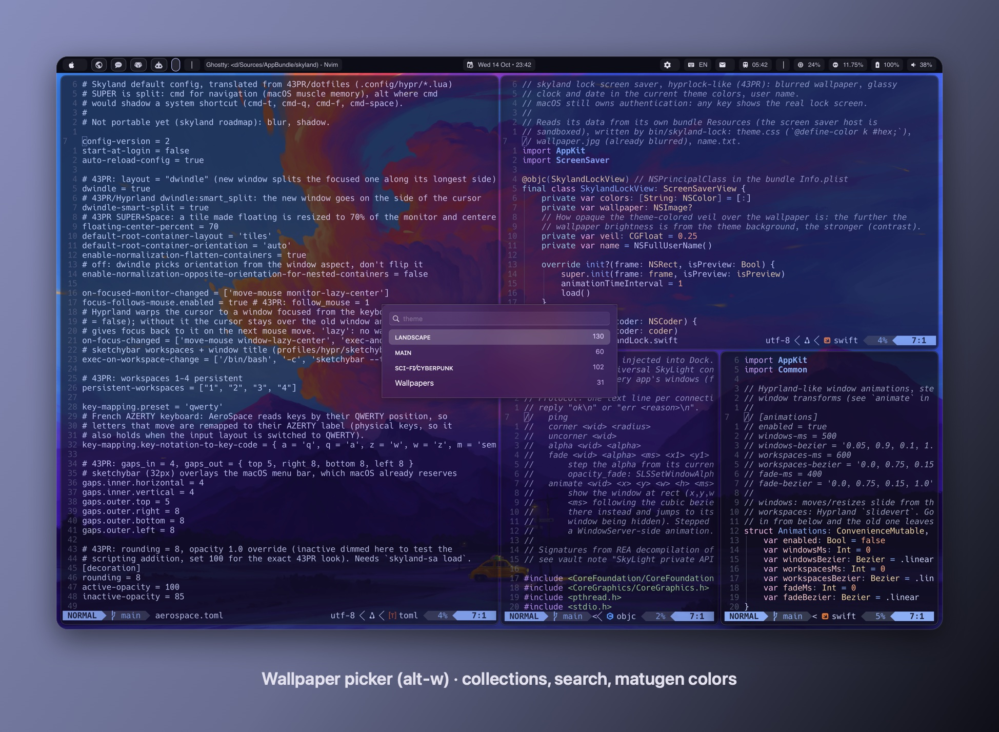
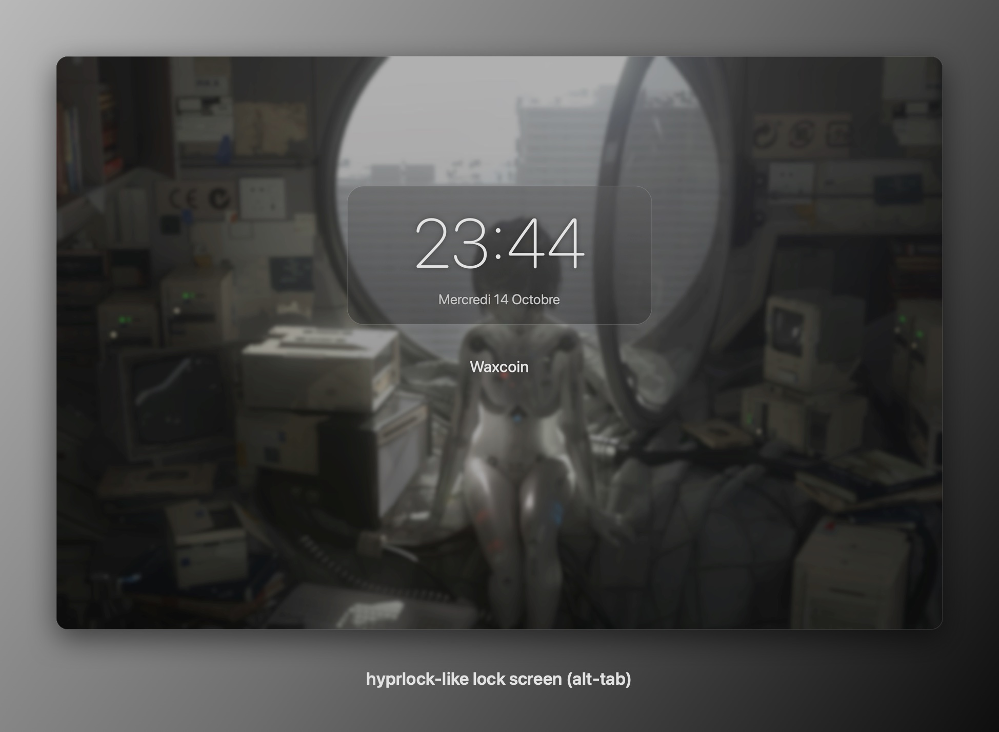

# skyland

A Hyprland-like tiling window manager for macOS, built as a fork of
[AeroSpace](https://github.com/nikitabobko/AeroSpace), with the look and
workflow of the [43PR Hyprland dotfiles](https://github.com/43PR/dotfiles).



skyland keeps everything AeroSpace does (virtual workspaces, tree layouts, CLI,
config file) and adds what makes Hyprland feel like Hyprland:

- **dwindle** layout, split side following the cursor (`smart_split`), `togglesplit`
- **move and resize with the mouse** anywhere on a window (`alt` + drag), tiles swap on drop
- **window decoration**: rounded corners, active/inactive opacity
- **bezier animations**: tiles slide, new windows pop in, closing windows shrink and fade, `slidefadevert` workspace switch, fades
- **43PR themes** as CSS files, light/dark toggle, **theme picker**, **colors generated from the wallpaper**
- **wallpaper picker**, **sketchybar** integration, **hyprlock-like screen saver**, **floating media widget** with audio-reactive bars
- **workspace overview** (`cmd-up`): every workspace as a card with its windows in place
- **shortcut cheat sheet** (`alt-shift-h`) read from the config
- windows **keep their workspace** across restarts
- a switch between this setup and a regular yabai/skhd setup (`skyland-env work|hypr`)



<table>
<tr>
<td></td>
<td></td>
</tr>
<tr>
<td align="center">Wallpaper picker (<code>alt-w</code>)</td>
<td align="center">Lock screen (<code>alt-tab</code>)</td>
</tr>
</table>

Screenshots are framed with `tools/frame-screenshot.swift`
(`swiftc -O tools/frame-screenshot.swift -o .build/frame-screenshot`).

> This is a personal setup. Paths like `~/code/hyperland/skyland` are hard-coded in
> the `hypr` profile bindings; adjust them if you clone elsewhere.

## How it works

The window manager is AeroSpace's Swift app with skyland additions under
`Sources/AppBundle/skyland/`. Everything AeroSpace cannot do through the public
Accessibility API (corner radius, alpha of other apps' windows, transforms for
animations) goes through a **scripting addition injected into Dock**: Dock owns
the universal SkyLight connection, so changes sent from there apply to every
app's windows. The payload (`osax/payload.m`) listens on
`/tmp/skyland-sa_$USER.socket` and the app sends it one text command per change.

- Animations and fades are **stepped by the payload** (`SLSSetWindowTransform`,
  `SLSSetWindowAlpha` every 8 ms). WindowServer-side animations are never used:
  an animated alpha crashed WindowServer when a window closed mid-fade.
- The private SkyLight signatures were recovered with REA (reverse engineering of
  the dyld shared cache on macOS 15.6.1).

## Requirements

- Apple Silicon Mac, macOS 15 (tested on 15.6.1)
- **SIP partially disabled** and the `-arm64e_preview_abi` boot-arg, exactly like
  [yabai's scripting addition](https://github.com/koekeishiya/yabai/wiki/Disabling-System-Integrity-Protection)
- Swift 6.4 through [swiftly](https://github.com/swiftlang/swiftly) (`swiftly install 6.4.0`)
- Homebrew: `cmake`, `jq`, `sketchybar`; optional `yabai` + `skhd` for the work profile
- `matugen` for wallpaper colors: `cargo install matugen`

## Build and install

```sh
git clone --recurse-submodules git@github.com:waxdred/skyland.git
cd skyland
bin/skyland-cert                     # once: self-signed identity, keeps Accessibility across rebuilds
bin/skyland-build                    # app, CLI, wallpaper picker, media widget
bin/skyland-sa build && bin/skyland-sa load   # scripting addition into Dock (sudo)
bin/skyland-lock install             # optional: lock screen saver
ln -s "$PWD"/bin/skyland-* /opt/homebrew/bin/  # the skyland CLI is .build/debug/aerospace
skyland-env hypr                     # switch to skyland
```

Grant **Accessibility** to `Skyland` (System Settings > Privacy & Security), and
only to the app: never to the scripts. Always start the app with `open` (or
`skyland-env`); launched from a terminal, macOS attributes the request to the
terminal and the app resets its own permission.

After `killall Dock` or a reboot the payload is gone: run `skyland-sa load` again
(see [autostart](#autostart) to automate it).

## Scripts

| Script | What it does |
|---|---|
| `skyland-env work\|hypr\|status` | switch between yabai/skhd and skyland (config overlay, services, bar, theme, one macOS Space per display with confirmation) |
| `skyland-build` | build everything with swiftly, sign `Skyland.app` |
| `skyland-sa build\|load\|send` | build / install and inject / talk to the Dock payload |
| `skyland-theme dark\|light\|toggle\|apply\|pick\|set <file>\|off` | apply a CSS theme to sketchybar and Ghostty; `pick` chooses one from color previews |
| `skyland-wallpaper pick\|set\|fetch` | picker, set wallpaper + generate colors, download wallhaven uploads |
| `skyland-lock install\|refresh\|now\|preview` | hyprlock-like screen saver |
| `skyland-media toggle\|open\|close` | floating media widget |
| `skyland-config <section> <key>` | read a value of the config (used by the scripts) |
| `skyland-cert` | create the `skyland-codesign` signing identity |

## Configuration

`profiles/hypr/.config/aerospace/aerospace.toml` is linked to
`~/.config/aerospace/aerospace.toml` by `skyland-env hypr`. All AeroSpace options
work ([AeroSpace guide](https://nikitabobko.github.io/AeroSpace/guide)); skyland adds:

```toml
dwindle = true                    # new window splits the focused one along its longest side
dwindle-smart-split = true        # ...on the side of the cursor (Hyprland smart_split)
floating-center-percent = 70      # 'layout floating' on a tile: N% of the monitor, centered
mouse-modifier = 'alt'            # alt + left drag moves, alt + right drag resizes (anywhere on a window)
bar-height = 32                   # keep windows below sketchybar on every screen (thinner external menu bars)
key-mapping.preset = 'input-source'  # letters follow the active keyboard layout (FR AZERTY / EN QWERTY)

[decoration]
rounding = 8
active-opacity = 100              # percent
inactive-opacity = 85
border-width = 2                  # focused window border, theme accent gradient (JankyBorders), 0 = none
blur = 5                          # Ghostty background blur, 0 = none

[animations]                      # Hyprland speed is in ds: speed 5 = 500 ms
enabled = true
windows-ms = 500
windows-bezier = '0.05, 0.9, 0.1, 1.0'   # Hyprland "bezier = name, x1, y1, x2, y2"
workspaces-ms = 600
workspaces-bezier = '0.0, 0.75, 0.15, 1.0'
fade-ms = 400
fade-bezier = '0.0, 0.75, 0.15, 1.0'

[theme]                           # GTK colors.css files: @define-color key #rrggbb;
dark = '~/.config/skyland/themes/43pr-catppuccin-mocha.css'
light = '~/.config/skyland/themes/43pr-white.css'

[wallpaper]
dir = '~/Pictures/Wallpapers'
dynamic-colors = true             # theme colors from the wallpaper (matugen)
prefer = 'saturation'
scheme = 'auto'                   # monochrome for grayscale wallpapers, else content

[lock]
name = 'Waxcoin'
blur = 4

[media]
opacity = 92
```

The 18 43PR themes are in `profiles/hypr/.config/skyland/themes/`: copy one and
edit the colors to make your own. `wallpaper-colors.json` maps Material roles to
theme keys (43PR's `semantic.json`).

`key-mapping.preset = 'input-source'` makes letters in bindings follow the active
keyboard layout (switching between French AZERTY and English QWERTY keeps
`alt-m` on the key that types "m"); digits keep their physical position.

The profile assigns **4 workspaces per screen** (1-4, 5-8, 9-12, screens left to
right, falling back left when fewer screens are plugged).

## Keybindings (hypr profile)

| Keys | Action | 43PR |
|---|---|---|
| `alt-t`, `alt-enter` | Ghostty | `Super+T` |
| `cmd-e` / `cmd-b` | Finder / Brave | `Super+E` / `Super+B` |
| `alt-q` | close window | `Super+Q` |
| `alt-f` | fullscreen | `Super+F` |
| `alt-space` | float 70% centered / tile back | `Super+Space` |
| `alt-j` | togglesplit | |
| `alt` + left drag / right drag | move (swap tiles) / resize from the nearest corner | `Super` + mouse |
| `cmd-h/j/k/l` | focus | `Super+H/J/K/L` |
| `cmd-shift-h/j/k/l` | move window | `Super+Shift+H/J/K/L` |
| `cmd-alt-h/j/k/l`, `cmd-alt-e` | resize, balance | `Super+Ctrl+H/J/K/L` |
| `cmd-1..0`, `cmd-shift-1..0` | workspace 1-10 (on its screen), move window there | `Super+1..0` |
| `cmd-left` / `cmd-right` | previous / next workspace | |
| `cmd-up` | workspace overview (arrows, digits, click, esc) | hyprexpo |
| `alt-l` | light / dark theme | `Super+L` |
| `alt-shift-l` | theme picker (43PR themes + wallpaper colors) | |
| `alt-shift-h` | shortcut list (read from the config) | |
| `alt-s` / `alt-shift-s` | scratchpad: show / hide it here, send the window to it (`alt-space` on a shown one takes it out) | Hyprland `togglespecialworkspace` |
| `alt-o` | inactive window opacity 100 / 90 / 80 / 70 | `Super+O` |
| `alt-p`, `alt-shift-p` | screenshot area (space: window), every display; to ~/Pictures/Screenshots + clipboard | `Shift+Delete`, `Delete` |
| `alt-d` | launcher (Raycast) | `Super+D` |
| `alt-w` | wallpaper picker | `Super+W` |
| `alt-tab` | lock screen | `Super+Tab` |
| `alt-m` | media widget | |
| `cmd-shift-e` | back to the work profile | `Super+Shift+E` |

## Autostart

Not installed by any script: both steps give extra privileges, so review and run
them yourself.

**1. Inject the payload without a password.** A sudoers rule allowing only the
root-owned loader, pinned to its sha256 (redo it after every
`skyland-sa build && skyland-sa load`, the hash changes):

```sh
LOADER=/Library/ScriptingAdditions/skyland.osax/Contents/MacOS/loader
ls -l "$LOADER"                       # must be owned by root
HASH=$(shasum -a 256 "$LOADER" | cut -d' ' -f1)
echo "$(whoami) ALL=(root) NOPASSWD: sha256:$HASH $LOADER" > /tmp/skyland.sudoers
sudo visudo -cf /tmp/skyland.sudoers && sudo install -m 0440 -o root -g wheel /tmp/skyland.sudoers /private/etc/sudoers.d/skyland
rm /tmp/skyland.sudoers
# then, any time: sudo -n "$LOADER" "$(pgrep -x Dock)"
# revoke: sudo rm /private/etc/sudoers.d/skyland
```

**2. Restore the last profile at login** with a LaunchAgent,
`~/Library/LaunchAgents/com.waxdred.skyland.plist`:

```xml
<?xml version="1.0" encoding="UTF-8"?>
<!DOCTYPE plist PUBLIC "-//Apple//DTD PLIST 1.0//EN" "http://www.apple.com/DTDs/PropertyList-1.0.dtd">
<plist version="1.0">
<dict>
    <key>Label</key><string>com.waxdred.skyland</string>
    <key>RunAtLoad</key><true/>
    <key>EnvironmentVariables</key>
    <dict>
        <key>PATH</key><string>/opt/homebrew/bin:/usr/bin:/bin:/usr/sbin:/sbin</string>
    </dict>
    <key>ProgramArguments</key>
    <array>
        <string>/bin/bash</string>
        <string>-c</string>
        <string>sleep 5; L=/Library/ScriptingAdditions/skyland.osax/Contents/MacOS/loader; sudo -n "$L" "$(pgrep -x Dock)"; S="$HOME/code/hyperland/skyland/bin/skyland-env"; "$S" "$("$S" status)"</string>
    </array>
    <key>StandardErrorPath</key><string>/tmp/skyland-login.log</string>
</dict>
</plist>
```

```sh
launchctl bootstrap gui/$(id -u) ~/Library/LaunchAgents/com.waxdred.skyland.plist   # enable
launchctl bootout gui/$(id -u)/com.waxdred.skyland                                   # disable
```

## Troubleshooting

- **A window is invisible**: `killall Dock` resets alpha and transforms set by the
  payload; `.build/debug/aerospace enable off` brings windows hidden in the corner back.
  skyland restores both on quit and on SIGTERM, not on SIGKILL.
- **No rounding / opacity / animations**: the payload is not loaded
  (`skyland-sa send ping` must answer `ok fade`): `skyland-sa load`.
- **Shortcuts do nothing**: check the Accessibility permission of `Skyland`.
- **Two windows share a workspace after clicking another app**: several macOS
  Spaces exist; skyland expects one per display (`skyland-env hypr` offers to
  remove the others).

## Credits and licenses

- [AeroSpace](https://github.com/nikitabobko/AeroSpace) by Nikita Bobko, MIT: the
  window manager skyland is forked from (`LICENSE.txt`).
- [yabai](https://github.com/koekeishiya/yabai) by Åsmund Vikane, MIT:
  `osax/loader.m` (Dock injection).
- [43PR/dotfiles](https://github.com/43PR/dotfiles), MIT: default config, themes,
  wallpaper color roles; wallpapers from [wallhaven](https://wallhaven.cc/user/43pr).
- [mediaremote-adapter](https://github.com/ungive/mediaremote-adapter), BSD-3-Clause:
  now playing information (git submodule).
- [matugen](https://github.com/InioX/matugen): Material colors from the wallpaper.
