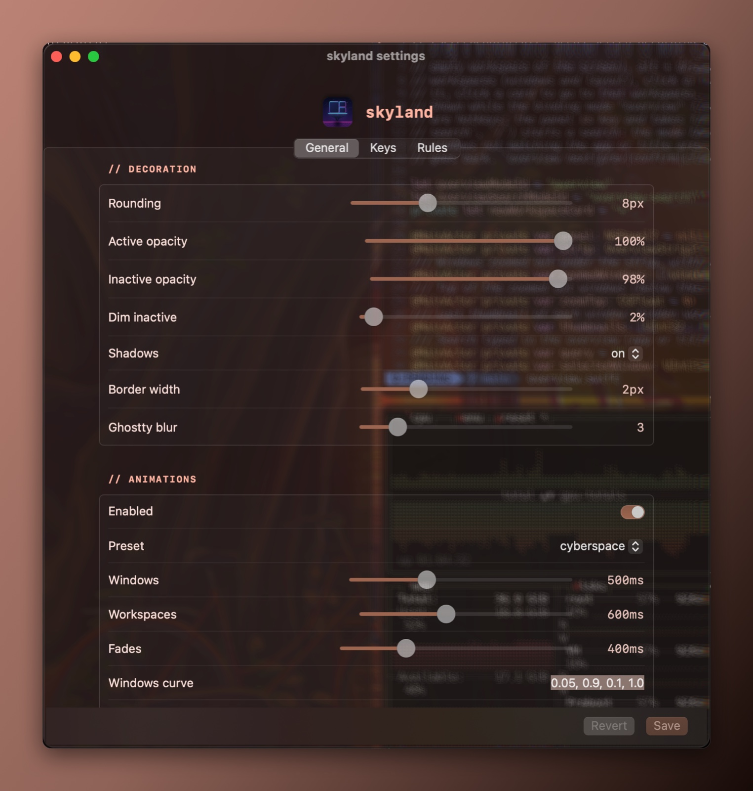
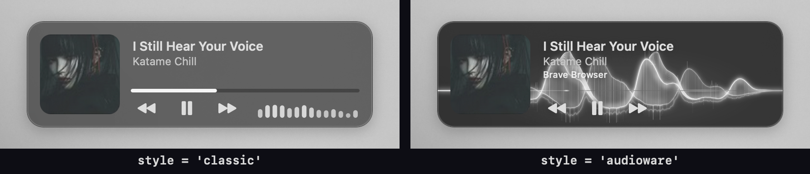

# skyland

A Hyprland-like tiling window manager for macOS, built as a fork of
[AeroSpace](https://github.com/nikitabobko/AeroSpace), with the look and
workflow of the [43PR Hyprland dotfiles](https://github.com/43PR/dotfiles).


skyland keeps everything AeroSpace does (virtual workspaces, tree layouts, CLI,
config file) and adds what makes Hyprland feel like Hyprland:

- **dwindle** layout, split side following the cursor (`smart_split`), `togglesplit`
- **move and resize with the mouse** anywhere on a window (`alt` + drag), tiles swap on drop
- **window decoration**: rounded corners, active/inactive opacity, dim inactive windows, focused window **border** in the theme accent (optionally rotating), Ghostty blur; floating windows stay on top
- **bezier animations**: tiles slide, new windows pop in, closing windows shrink and fade, `slidefadevert` workspace switch, fades
- **43PR themes** as CSS files, light/dark toggle, **theme picker**, **colors generated from the wallpaper**, light or dark picked from the wallpaper brightness
- **wallpaper picker**, **sketchybar** integration, **hyprlock-like screen saver**, **floating media widget** with audio-reactive bars or an Audioware-style light wave (`[media] style`)
- **workspace overview** (`cmd-up`): every workspace as a card with its windows in place
- **settings window** (`alt-i`): gaps, decoration, animations, wallpaper, media widget and lock screen, plus **Keys** (record a key, edit command and description, duplicates and macOS shortcuts flagged) and **Rules** (float / tile / workspace per app, from the running apps) tabs; applied live and written to the config with its comments kept
- **master layout** per workspace (`alt-shift-t`): one big window and a stack on the side (master in the middle on ultrawide screens), `alt-shift-enter` swaps with the master (Hyprland `master`, `swapwithmaster`)
- **groups** (`alt-g`): a container becomes tabs with a tabs bar, `alt-n` cycles, `alt-ctrl-h/j/k/l` groups with a neighbour (Hyprland `togglegroup`, `changegroupactive`, `moveintogroup`)
- **scratchpads** (`alt-s`, named ones like `alt-a` = Spotify), **window rules** (floating utilities, apps sent to a workspace)
- **window management on/off** (`alt-r`) with a HUD, windows back to stock macOS while off
- **shortcut cheat sheet** (`alt-shift-h`) read from the config
- windows **keep their workspace** across restarts
- companion **[skyland-cyberdeck](https://github.com/waxdred/skyland-cyberdeck)**: cyberpunk apps launcher (`alt-d`) and messages panel (`alt-shift-m`) with a scripting API, notifications from mail and herdr agents

What changed in each version: [CHANGELOG.md](CHANGELOG.md).


<table>
<tr>
<td></td>
<td></td>
</tr>
<tr>
<td align="center">Wallpaper picker (<code>alt-w</code>)</td>
<td align="center">Lock screen (<code>alt-tab</code>)</td>
</tr>
</table>

<p align="center"><br>Settings window (<code>alt-i</code>)</p>

Screenshots are framed with `tools/frame-screenshot.swift`
(`swiftc -O tools/frame-screenshot.swift -o .build/frame-screenshot`).

> Clone it anywhere: bindings call the `skyland` CLI, and skyland puts its own
> `bin/` (and `~/.local/bin`) on the PATH of `exec-and-forget` commands.

## skyland-cyberdeck

[skyland-cyberdeck](https://github.com/waxdred/skyland-cyberdeck) is a separate repo
with the cyberpunk HUD pieces, bound in the hypr profile:

- **apps launcher** (`alt-d`): a see-through "eye implant" deck, curved column of
  apps, type to search
- **messages** (`alt-shift-m`, `alt-shift-x` dismisses all): the macOS Notification
  Center history and script messages as neon contact cards
- **scripting API**: `skyland-cyberdeck notify -t TITLE -b BODY`, `list --json`,
  `dismiss`; integrations for a sketchybar mail item and
  [herdr](https://herdr.dev) agents (finished / needs you)

<table>
<tr>
<td></td>
<td></td>
</tr>
</table>

```sh
git clone https://github.com/waxdred/skyland-cyberdeck.git && cd skyland-cyberdeck
swift build -c release && ln -s "$PWD/.build/release/skyland-cyberdeck" ~/.local/bin/
```

## How it works

The window manager is AeroSpace's Swift app with skyland additions under
`Sources/AppBundle/skyland/`. Everything AeroSpace cannot do through the public
Accessibility API (corner radius, alpha of other apps' windows, transforms for
animations) goes through a **scripting addition injected into Dock**: Dock owns
the universal SkyLight connection, so changes sent from there apply to every
app's windows. The payload (`osax/payload.m`) listens on
`/tmp/skyland-sa_$USER.socket` and the app sends it one text command per change.

- Animations and fades are **stepped by the payload** (`SLSSetWindowTransform`,
  `SLSSetWindowAlpha` every 8 ms). WindowServer-side animations are never used:
  an animated alpha crashed WindowServer when a window closed mid-fade.
- The private SkyLight signatures were recovered with REA (reverse engineering of
  the dyld shared cache on macOS 15.6.1).

## Requirements

- Apple Silicon Mac, macOS 15 (tested on 15.6.1), [Homebrew](https://brew.sh)
- everything else comes with `skyland install`: Swift 6.4 through
  [swiftly](https://github.com/swiftlang/swiftly), `cmake`, `jq`, `sketchybar`,
  `borders`, Hack Nerd Font (see `Brewfile`); `matugen` for wallpaper colors
  (`cargo install matugen`, done when `cargo` is there)
- **optional, for window effects** (corners, opacity, animations, floating windows
  on top): SIP partially disabled and the `-arm64e_preview_abi` boot-arg, exactly
  like [yabai's scripting addition](https://github.com/koekeishiya/yabai/wiki/Disabling-System-Integrity-Protection).
  Without it everything else works: tiling, groups, master, scratchpads, overview,
  themes, wallpapers, settings

## Install

### Quick start (SIP on, nothing to disable)

With [Homebrew](https://github.com/waxdred/homebrew-tap):

```sh
brew install waxdred/tap/skyland
skyland install       # dependencies, signing identity, config in ~/.config, start
skyland doctor        # what works, what is missing, how to fix it
```

After `brew upgrade skyland`: `skyland env` restarts it; your config in `~/.config`
is kept (an upgrade only adds new themes).

Or from source:

```sh
git clone --recurse-submodules https://github.com/waxdred/skyland.git
cd skyland
bin/skyland-install   # dependencies, Swift, signing identity, build, `skyland` CLI, start
skyland doctor        # what works, what is missing, how to fix it
```

Or, without building anything (no Swift toolchain): download `skyland-<version>.zip`
from [Releases](https://github.com/waxdred/skyland/releases), unzip it, then
`bin/skyland-install` in it.

`skyland install` runs again safely (each step skips what is there). Then allow
**Skyland** in System Settings > Privacy & Security > **Accessibility** (and Screen
Recording for the overview thumbnails and the media widget bars). Always start the
app with `open` or `skyland env`: launched from a terminal, macOS gives the request to
the terminal and the app resets its own permission.

With SIP on you get everything but the window effects:

| works with SIP on | needs the Dock payload (SIP off) |
|---|---|
| dwindle / master / groups / scratchpads, window rules | rounded corners |
| alt + mouse move and resize | active / inactive opacity, `alt-o` |
| workspaces per screen, overview with live thumbnails | window and workspace animations, fades |
| themes, theme picker, wallpaper picker and colors, light / dark | floating windows kept on top |
| sketchybar, focused window border (JankyBorders), Ghostty blur | |
| settings window, cheat sheet, lock screen saver, media widget, cyberdeck | |

### Full effects (SIP partially off)

Like [yabai's scripting addition](https://github.com/koekeishiya/yabai/wiki/Disabling-System-Integrity-Protection):
from recovery mode `csrutil enable --without fs --without debug --without nvram`,
then `sudo nvram boot-args=-arm64e_preview_abi` and reboot. Then:

```sh
skyland sa build && skyland sa load   # build and inject the payload into Dock (sudo)
skyland doctor                        # "payload loaded in Dock"
```

After a reboot or `killall Dock` the payload is gone: `skyland sa load` again, or
let the LaunchAgent do it (see [autostart](#autostart)).

### Optional

```sh
skyland lock install    # hyprlock-like lock screen saver
skyland uninstall       # remove everything but the repo (asks first)
```

Everything goes through the `skyland` CLI (`~/.local/bin/skyland`): `skyland theme pick`,
`skyland scratch toggle`, and any window manager command (`skyland workspace 3`,
`skyland list-windows --all`, `skyland reload-config`).

## Scripts

| Script | What it does |
|---|---|
| `skyland install` | first install / update: dependencies, Swift, build, CLI, start |
| `skyland doctor` | check the install (permissions, SIP, payload, sudoers, bar, border...) and say what to fix |
| `skyland uninstall` | remove skyland but the repo (asks first) |
| `skyland-env [hypr]\|status` | set up skyland: link the hypr profile into `~/.config`, start the app, sketchybar with skyland workspaces (run at login) |
| `skyland-build` | build everything with swiftly, sign `Skyland.app` |
| `skyland-sa build\|load\|send` | build / install and inject / talk to the Dock payload |
| `skyland-theme dark\|light\|toggle\|apply\|pick\|set <file>\|off` | apply a CSS theme to sketchybar and Ghostty; `pick` chooses one from color previews |
| `skyland-wallpaper pick\|set\|fetch` | picker, set wallpaper + generate colors, download wallpapers from wallhaven (see below) |
| `skyland-lock install\|refresh\|now\|preview` | hyprlock-like screen saver |
| `skyland-media toggle\|open\|close` | floating media widget |
| `skyland-config <section> <key>` | read a value of the config (used by the scripts) |
| `skyland-cert` | create the `skyland-codesign` signing identity |

### macOS appearance (optional)

With an `[appearance]` table, every theme change also sets System Settings >
Appearance, so Finder, Mail, Settings and the other apps match:

```toml
[appearance]
sync-dark-mode = true   # macOS dark / light follows skyland (alt-l, wallpaper auto-mode)
accent = 'theme'        # the macOS accent closest to the theme accent | 'off' | blue, purple,
                        # pink, red, orange, yellow, green, graphite, multicolor
highlight = 'theme'     # text selection: the theme accent lightened (any color, not only the
                        # 8 of System Settings) | 'off' | a preset | '#rrggbb'
```

The values found before the first change are kept: `skyland appearance restore` puts
them back. The first dark / light switch asks to let Skyland control System Events.
Also in the settings window (`alt-i`).

### Wallpapers

`skyland-wallpaper fetch` downloads SFW wallpapers from [wallhaven](https://wallhaven.cc)
into `[wallpaper] dir` (default `~/Pictures/Wallpapers`), no account or API key needed.
A collection goes into its own folder, named after its label; the picker (`alt-w`)
shows these folders first, with a search field, then the wallpapers of the chosen one.

```sh
skyland-wallpaper fetch                       # uploads of the 43PR user, into dir
skyland-wallpaper fetch <user>                # uploads of another user
skyland-wallpaper fetch <user>/favorites/<id> # one public collection, into dir/<label>
skyland-wallpaper fetch <user>/favorites      # every public collection of the user
skyland-wallpaper fetch https://wallhaven.cc/user/43PR/favorites/1262809   # page URL works too
```

`<id>` is the number at the end of the collection page URL
(`https://wallhaven.cc/user/<user>/favorites/<id>`). Files already there are skipped,
so running it again only downloads what is new. Then `alt-w` or
`skyland-wallpaper set <file>`; with `dynamic-colors = true` the theme colors are
generated from the image (matugen).

## Configuration

`profiles/hypr/.config/aerospace/aerospace.toml` is linked to
`~/.config/aerospace/aerospace.toml` by `skyland-env hypr`. All AeroSpace options
work ([AeroSpace guide](https://nikitabobko.github.io/AeroSpace/guide)); skyland adds:

```toml
dwindle = true                    # new window splits the focused one along its longest side
dwindle-smart-split = true
master-ratio = 55                 # master layout (alt-shift-t): master width in percent, Hyprland mfact
master-orientation = 'auto'       # left | center | auto (center on ultrawide screens)
master-workspaces = []            # workspaces in the master layout at the very first start        # ...on the side of the cursor (Hyprland smart_split)
floating-center-percent = 70      # 'layout floating' on a tile: N% of the monitor, centered
mouse-modifier = 'alt'            # alt + left drag moves, alt + right drag resizes (anywhere on a window)
bar-height = 32                   # keep windows below sketchybar on every screen (thinner external menu bars)
key-mapping.preset = 'input-source'  # letters follow the active keyboard layout (FR AZERTY / EN QWERTY)

[decoration]
rounding = 8
active-opacity = 100              # percent
inactive-opacity = 85
dim-inactive = 20                 # darken unfocused windows, percent (Dock payload), 0 = none
border-width = 2                  # focused window border, theme accent gradient (JankyBorders), 0 = none
border-rotate-ms = 4000           # the border gradient turns, one turn in ms (skyland draws it), 0 = static
blur = 5                          # Ghostty background blur, 0 = none
group-bar-height = 22             # accordion containers become groups with a tabs bar, 0 = AeroSpace accordion

[animations]                      # Hyprland speed is in ds: speed 5 = 500 ms
enabled = true
windows-ms = 500
windows-bezier = '0.05, 0.9, 0.1, 1.0'   # Hyprland "bezier = name, x1, y1, x2, y2"
workspaces-ms = 600
workspaces-bezier = '0.0, 0.75, 0.15, 1.0'
fade-ms = 400
fade-bezier = '0.0, 0.75, 0.15, 1.0'

[theme]                           # GTK colors.css files: @define-color key #rrggbb;
dark = '~/.config/skyland/themes/43pr-catppuccin-mocha.css'
light = '~/.config/skyland/themes/43pr-white.css'

[wallpaper]
dir = '~/Pictures/Wallpapers'
dynamic-colors = true             # theme colors from the wallpaper (matugen)
prefer = 'saturation'
scheme = 'auto'                   # monochrome for grayscale wallpapers, else content
auto-mode = true                  # light theme for a bright wallpaper, dark for a dark one (alt-l still toggles)

[lock]
name = 'Neo'                      # lock screen name, default: your macOS full name
blur = 4

[media]
opacity = 92
style = 'classic'                 # or 'audioware': a light wave in the theme's accent, the center line is the progress
```

The **media widget** (`alt-m`) shows what any app plays (Spotify, Brave / YouTube,
Music...) and follows the theme, in two styles:



The 18 43PR themes are in `profiles/hypr/.config/skyland/themes/`: copy one and
edit the colors to make your own. `wallpaper-colors.json` maps Material roles to
theme keys (43PR's `semantic.json`).

`key-mapping.preset = 'input-source'` makes letters in bindings follow the active
keyboard layout (switching between French AZERTY and English QWERTY keeps
`alt-m` on the key that types "m"); digits keep their physical position.

The profile assigns **4 workspaces per screen** (1-4, 5-8, 9-12, screens left to
right, falling back left when fewer screens are plugged).

## Keybindings (hypr profile)

| Keys | Action | 43PR |
|---|---|---|
| `alt-t`, `alt-enter` | Ghostty | `Super+T` |
| `cmd-e` / `cmd-b` | Finder / Brave | `Super+E` / `Super+B` |
| `alt-q` | close window | `Super+Q` |
| `alt-f` | fullscreen | `Super+F` |
| `alt-space` | float 70% centered / tile back | `Super+Space` |
| `alt-j` | togglesplit | |
| `alt` + left drag / right drag | move (swap tiles) / resize from the nearest corner | `Super` + mouse |
| `cmd-h/j/k/l` | focus | `Super+H/J/K/L` |
| `cmd-shift-h/j/k/l` | move window | `Super+Shift+H/J/K/L` |
| `cmd-alt-h/j/k/l`, `cmd-alt-e` | resize, balance | `Super+Ctrl+H/J/K/L` |
| `cmd-1..0`, `cmd-shift-1..0` | workspace 1-10 (on its screen), move window there | `Super+1..0` |
| `cmd-left` / `cmd-right` | previous / next workspace | |
| `cmd-up` | workspace overview (arrows, digits, click, esc) | hyprexpo |
| `alt-l` | light / dark theme | `Super+L` |
| `alt-shift-l` | theme picker (43PR themes + wallpaper colors) | |
| `alt-shift-h` | shortcut list (read from the config) | |
| `alt-s` / `alt-shift-s` | scratchpad: show / hide it here, send the window to it (`alt-space` on a shown one takes it out) | Hyprland `togglespecialworkspace` |
| `alt-a` | named scratchpad `music`: Spotify, started if needed (`skyland-scratch toggle <name> --app <bundle id>`) | `special:music` |
| `alt-g` | group: the container becomes tabs (tabs bar on top), again: tiles | `togglegroup` |
| `alt-shift-t` | master layout on / off for this workspace (remembered) | `layout master` |
| `alt-shift-enter` | swap the focused window with the master | `swapwithmaster` |
| `alt-n`, `alt-shift-n` | next / previous tab of the group (`group-focus`) | `changegroupactive` |
| `alt-ctrl-h/j/k/l` or `alt-ctrl-←↓↑→` | group with the window in that direction | `moveintogroup` |
| `alt-i` | settings window: gaps, decoration, animations, wallpaper, media, lock (applied live, comments kept) | `Super+I` |
| `alt-r` | window management off / on (stock macOS windows while off), HUD with the state | |
| `alt-o` | inactive window opacity 100 / 90 / 80 / 70 | `Super+O` |
| `alt-p`, `alt-shift-p` | screenshot area (space: window), every display; to ~/Pictures/Screenshots + clipboard | `Shift+Delete`, `Delete` |
| `alt-d` | apps launcher ([skyland-cyberdeck](https://github.com/waxdred/skyland-cyberdeck)) | `Super+D` |
| `alt-shift-m`, `alt-shift-x` | messages panel (notifications + script messages), dismiss all | `Super+Shift+M`, `Super+Shift+X` |
| `alt-w` | wallpaper picker | `Super+W` |
| `alt-tab` | lock screen | `Super+Tab` |
| `alt-m` | media widget | |

### SketchyBar

skyland does not ship a bar config: keep your own `sketchybarrc`, and connect it
with one line at its end:

```sh
[ -x "$HOME/.local/bin/skyland" ] && "$HOME/.local/bin/skyland" bar >/dev/null 2>&1 &
```

(full path: sketchybar started by `brew services` has a short PATH without `~/.local/bin`)

`skyland bar` (`profiles/hypr/sketchybar/skyland.sh`) then:

- removes the `space.*` items (macOS Spaces) and adds `workspace.1` to `workspace.12`:
  each one is drawn on the screen of its workspace, only when the workspace exists,
  the focused one highlighted, a click goes there
- puts them before an item named **`space_separator`** if your config has one (else
  at the end of the left side)
- writes the focused window as `App: title` into an item named **`window_title`**,
  if there is one
- sets `topmost=on`, so the workspace icons get the clicks; skyland hides the bar
  while the auto-hidden macOS menu bar slides in
- recolors the bar with the current theme (`skyland theme apply`; the colors are also
  in `~/.cache/skyland/theme.env` for your own plugins: `BAR_BG`, `TEXT`, `ACCENT`...)

skyland fires the `skyland_update` event on focus and workspace changes
(`on-focus-changed`, `exec-on-workspace-change` in the config): subscribe your own
items to it. For anything else, query the CLI, e.g.
`skyland list-workspaces --focused` or `skyland list-windows --focused --format '%{app-name}'`.

## Autostart

Both steps give extra privileges: nothing is set up without you saying so.

**1. Inject the payload without a password.** A sudoers rule allowing only the
root-owned loader, pinned to its sha256. `skyland sa load` offers to write it
(answer `y`) and renews it after each rebuild, since the hash changes. By hand:

```sh
LOADER=/Library/ScriptingAdditions/skyland.osax/Contents/MacOS/loader
ls -l "$LOADER"                       # must be owned by root
HASH=$(shasum -a 256 "$LOADER" | cut -d' ' -f1)
echo "$(whoami) ALL=(root) NOPASSWD: sha256:$HASH $LOADER" > /tmp/skyland.sudoers
sudo visudo -cf /tmp/skyland.sudoers && sudo install -m 0440 -o root -g wheel /tmp/skyland.sudoers /private/etc/sudoers.d/skyland
rm /tmp/skyland.sudoers
# then, any time: sudo -n "$LOADER" "$(pgrep -x Dock)"
# revoke: sudo rm /private/etc/sudoers.d/skyland
```

**2. Restore the last profile at login** with a LaunchAgent,
`~/Library/LaunchAgents/com.waxdred.skyland.plist`:

```xml
<?xml version="1.0" encoding="UTF-8"?>
<!DOCTYPE plist PUBLIC "-//Apple//DTD PLIST 1.0//EN" "http://www.apple.com/DTDs/PropertyList-1.0.dtd">
<plist version="1.0">
<dict>
    <key>Label</key><string>com.waxdred.skyland</string>
    <key>RunAtLoad</key><true/>
    <key>EnvironmentVariables</key>
    <dict>
        <key>PATH</key><string>/opt/homebrew/bin:/usr/bin:/bin:/usr/sbin:/sbin</string>
    </dict>
    <key>ProgramArguments</key>
    <array>
        <string>/bin/bash</string>
        <string>-c</string>
        <string>sleep 5; L=/Library/ScriptingAdditions/skyland.osax/Contents/MacOS/loader; sudo -n "$L" "$(pgrep -x Dock)"; S="$HOME/.local/bin/skyland"; "$S" env</string>
    </array>
    <key>StandardErrorPath</key><string>/tmp/skyland-login.log</string>
</dict>
</plist>
```

```sh
launchctl bootstrap gui/$(id -u) ~/Library/LaunchAgents/com.waxdred.skyland.plist   # enable
launchctl bootout gui/$(id -u)/com.waxdred.skyland                                   # disable
```

## Troubleshooting

Start with `skyland doctor`: it checks the whole install and prints the fix for
each problem.

- **A window is invisible**: `killall Dock` resets alpha and transforms set by the
  payload; `skyland enable off` brings windows hidden in the corner back.
  skyland restores both on quit and on SIGTERM, not on SIGKILL.
- **No rounding / opacity / animations**: the payload is not loaded
  (`skyland-sa send ping` must answer `ok fade`): `skyland-sa load`.
- **Shortcuts do nothing**: check the Accessibility permission of `Skyland`.
- **Two windows share a workspace after clicking another app**: several macOS
  Spaces exist; skyland expects one per display: remove the others in Mission
  Control.

## Credits and licenses

- [AeroSpace](https://github.com/nikitabobko/AeroSpace) by Nikita Bobko, MIT: the
  window manager skyland is forked from (`LICENSE.txt`).
- [yabai](https://github.com/koekeishiya/yabai) by Åsmund Vikane, MIT:
  `osax/loader.m` (Dock injection).
- [43PR/dotfiles](https://github.com/43PR/dotfiles), MIT: default config, themes,
  wallpaper color roles; wallpapers from [wallhaven](https://wallhaven.cc/user/43pr).
- [mediaremote-adapter](https://github.com/ungive/mediaremote-adapter), BSD-3-Clause:
  now playing information (git submodule).
- [matugen](https://github.com/InioX/matugen): Material colors from the wallpaper.
